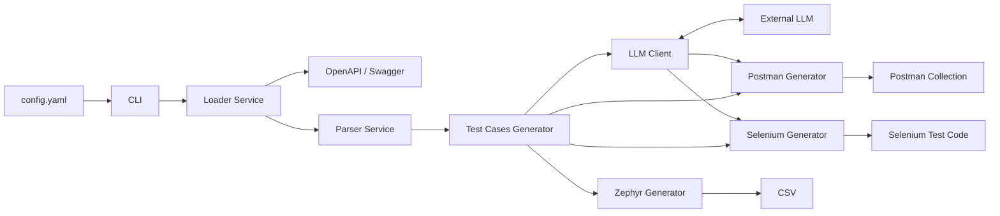

# OpenAPI Test Generator

Проект создан как учебный прототип в рамках ознакомительной практики от ВУЗа в лаборатории компании YADRO “Технологии программирования Yadro-Политех”.

CLI-приложение на Java и Spring Boot для автоматизации подготовки тестов REST API по OpenAPI/Swagger-спецификации.

Система загружает и анализирует описание API, формирует позитивные, негативные и граничные тестовые сценарии, а затем преобразует их в готовые артефакты для Postman, Selenium и Zephyr. Для смысловой генерации сценариев и исполняемого кода используется внешняя LLM.

## Возможности

- загрузка OpenAPI/Swagger-спецификации по URL;
- работа с прямыми ссылками на JSON или YAML;
- поиск спецификации на странице Swagger UI;
- проверка резервных путей:
  - `/swagger.json`;
  - `/openapi.json`;
  - `/v3/api-docs`;
- разбор эндпоинтов, HTTP-методов, параметров, тел запросов, схем и ответов;
- генерация позитивных, негативных и граничных тест-кейсов;
- централизованное взаимодействие с внешней LLM;
- экспорт тест-кейсов в CSV для Zephyr;
- генерация Postman Collection;
- генерация Selenium-тестов;
- запуск основных сценариев через CLI;
- логирование основных этапов работы;
- модульное тестирование ключевых компонентов.

## Как это работает

1. CLI считывает параметры приложения и запускает выбранный сценарий.
2. Loader Service получает OpenAPI-спецификацию по указанному URL.
3. Parser Service преобразует исходное описание в структурированную модель API.
4. Генератор формирует данные для позитивных, негативных и граничных проверок.
5. LLM дополняет формальные сведения содержательными сценариями и кодом.
6. Результат сохраняется в выбранном формате.

## Архитектура

Приложение реализовано как модульный монолит на базе Spring Boot. Все компоненты работают внутри одного процесса и имеют четко разделенные зоны ответственности.

| Компонент | Назначение |
|---|---|
| `CLI` | Точка входа и управление процессом генерации |
| `Loader Service` | Загрузка спецификации и поиск доступного OpenAPI-описания |
| `Parser Service` | Преобразование спецификации в структурированную модель |
| `Test Cases Generator` | Подготовка позитивных, негативных и граничных сценариев |
| `Prompt Builder` | Формирование инструкций и данных для LLM |
| `LLM Client` | Единая точка взаимодействия с внешней языковой моделью |
| `Zephyr Generator` | Экспорт тест-кейсов в CSV |
| `Postman Generator` | Формирование коллекции запросов и тестовых скриптов |
| `Selenium Generator` | Генерация файла с тестовым кодом |

Такое разделение позволяет добавлять новые форматы экспорта без повторной реализации загрузки и разбора OpenAPI.

## Технологии

- Java
- Spring Boot
- Spring Shell
- OpenAPI / Swagger
- OpenAPIV3Parser
- Maven
- JUnit 5
- Mockito
- JaCoCo
- Postman
- Selenium
- Zephyr
- Docker
- Git

## Конфигурация

Основные параметры задаются в `config.yaml`:

- URL OpenAPI/Swagger-спецификации;
- формат выходного артефакта;
- базовый URL LLM API;
- идентификатор модели;
- параметры генерации;
- настройки логирования.

## Выходные артефакты

### Zephyr CSV

Содержит данные для ручного импорта тест-кейсов:

- название сценария;
- предусловия;
- шаги;
- тестовые данные;
- ожидаемый результат.

### Postman Collection

Содержит:

- HTTP-методы;
- URL с переменной `{{baseUrl}}`;
- параметры и заголовки;
- тело запроса;
- тестовые скрипты для проверки статуса и полей ответа.

### Selenium Tests

Содержит сгенерированный код UI-тестов на основе подготовленных тест-кейсов. Для создания программного кода используется дополнительный запрос к LLM.

## Статус проекта

Рабочий учебный прототип. Проект автоматизирует основные этапы подготовки тестов REST API и может использоваться как основа для дальнейшего развития.
